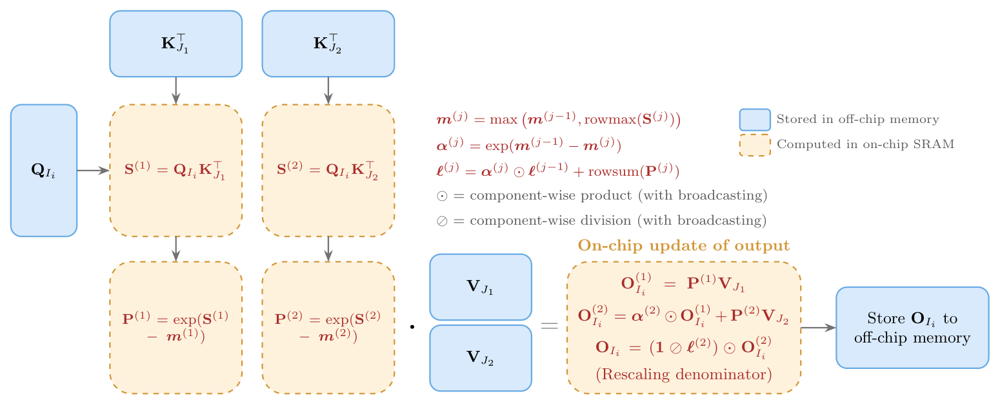

Performance Evaluation of FlashAttention-2 for Inference on CPU
=======================
This repository contains implementations of the FlashAttention-2 forward kernel run on CPU. Standard attention baselines are also provided. For causal attention, three scheduling strategies are implemented: static, centralized dynamic, and work-stealing.

The technical report, including algorithm derivation, complexity analysis, and interpretation, is available here:
* [Performance Evaluation of FlashAttention-2 for Inference on CPU (PDF)](./flashattn2-cpu-report.pdf)

Abstract
------------
**TL;DR:** We evaluate the performance of FlashAttention-2 forward kernel for inference on CPU.

FlashAttention has revolutionized transformer training and inference on GPU by minimizing memory I/O, yet its behavior on CPU remains underexplored. We evaluate the FlashAttention-2 (FA-2) forward kernel for inference on a single CPU against standard attention and PyTorch's scaled dot-product attention (SDPA). For masked attention, we compare three scheduling strategies for parallelizing the kernel. We further profile the runtime breakdown of the kernel's algorithmic steps. For self-attention, FA-2 is up to 1.6× faster than SDPA on short sequences and matches it on long sequences; for masked attention, FA-2 is 1.39–1.69× faster on long sequences. Profiling shows that the masked-attention gain comes from load balancing: dynamic and work-stealing scheduling leave 2–5% of thread time idle, while static scheduling leaves 45%. Our analysis serves as a preliminary exploration of efficient attention computations in resource-constrained settings, including CPU-only inference.

<br>
<p align="center">
  
  <br>
  <em>Figure 1: Computation of the FlashAttention-2 forward kernel.</em>
</p>

Repository Layout
------------
```
include/flash_attn/   C++ API: naive attention, FA-2 kernels, matrix I/O
src/                  C++ kernels (serial, OpenMP, causal schedulers, profiling)
flash_attn/           NumPy and Numba implementations
benchmarks/           Benchmark drivers for each implementation and PyTorch SDPA
data_generation.py    Random Q, K, V test sets
plot.py               Paper figures from the benchmark logs
paper_stats.py        Every number quoted in the paper's results
run.sh                Full benchmark sweep
```

Dependencies
------------
- **Python:** numpy, scipy, numba, pandas, matplotlib, SciencePlots, PyTorch (tested with 2.6.0, for the SDPA baseline)
- **C++:** OpenMP, CMake ≥ 3.16, GCC ≥ 10 (or another C++17 compiler). CMake downloads Eigen 5.0.1 (header-only) at configure time

Usage
-----
```bash
cmake -S . -B build -DCMAKE_CXX_COMPILER=g++-11 && cmake --build build --parallel
bash run.sh
```

Logs go to `outputs/<impl>/runtime.csv`; plots go to `plots/`. `python paper_stats.py` prints the numbers quoted in the paper.

Each benchmark resumes from existing CSV entries if interrupted.
